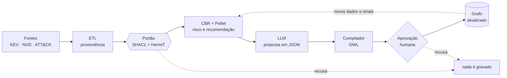

# OntoCSIRT v7

[](https://github.com/Stefanossq/OntoCSIRT-v7/actions/workflows/testes.yml)

Ontologia OWL 2 DL com regras SWRL para análise de incidentes de cibersegurança e recomendação de resposta por raciocínio baseado em casos (CBR). Ela se alimenta de fontes públicas (CISA KEV, NVD, MITRE ATT&CK, CWE) e responde a alertas de SOAR por um webhook HTTP. A sua estrutura evolui por propostas verificadas por raciocinadores e aprovadas por um analista.

> **O modelo de linguagem propõe, a lógica verifica e o humano decide.** Nada entra no grafo sem passar por SHACL e HermiT; nada muda a estrutura da ontologia sem aprovação explícita.



Diagrama detalhado (ficheiros de cada passo): [`docs/ciclo_de_vida.mmd`](docs/ciclo_de_vida.mmd). Explicação fase a fase: [`docs/MASTERCLASS.md`](docs/MASTERCLASS.md).

**Autor:** Stefano Camargo · **Artigo:** [`artigo/artigo_ontocsirt_submissao.tex`](artigo/artigo_ontocsirt_submissao.tex) · **Como citar:** [`CITATION.cff`](CITATION.cff)

---

## Para a banca: verificar em 3 comandos

Precisa de Python 3.10+ e Java 8+ (ou só do Docker; ver abaixo). Não precisa de rede depois da instalação nem de chaves de API.

```bash
git clone https://github.com/Stefanossq/OntoCSIRT-v7.git && cd OntoCSIRT-v7
pip install -r requirements.txt
python verificar_ontologia.py
```

O último comando leva cerca de 1 minuto e imprime um checklist com 40 verificações:
- a sintaxe Turtle de cada ficheiro;
- o SHA-256 da base citada no artigo;
- o HermiT, o Pellet com as regras SWRL e o SHACL, em cinco composições da ontologia;
- as 8 questões de competência;
- 5 defeitos injetados de propósito, que o portão tem de recusar.

Termina com `TUDO OK: 40/40` e código de saída 0.

Com Docker, sem instalar Python nem Java:

```bash
docker build -t ontocsirt-webhook:7 .
docker run --rm --entrypoint python ontocsirt-webhook:7 verificar_ontologia.py
docker run --rm --entrypoint python ontocsirt-webhook:7 -m pytest -q tests -p no:warnings
```

A suíte completa (164 testes, cerca de 8 minutos) é `python -m pytest -q tests`. A secção seguinte mostra como subir o webhook e enviar um alerta real. O relatório da última revisão está em [`docs/RELATORIO_REVISAO_2026-11-04.md`](docs/RELATORIO_REVISAO_2026-11-04.md).

| Pergunta da banca | Onde ver |
|---|---|
| A ontologia é consistente? | `python verificar_ontologia.py`, secção 3 |
| Responde às questões de competência? | secção 4; as consultas SPARQL estão em `ontocsirt_v7.py` (`CQS`) |
| De onde vêm os números do artigo? | `python ontocsirt_v7.py all` regenera `evidence_v7/*.json` e `artigo/numbers_v7.tex` |
| Como evolui sem perder consistência? | [Como a ontologia se incrementa](#como-a-ontologia-se-incrementa) e `evolution/CHANGELOG.json` |
| Abrir no Protégé | `OntoCSIRT_v7.ttl` (base) e depois `OntoCSIRT_v7_ext.ttl` e `OntoCSIRT_v7_evo.ttl` |

---

## Replicar em 5 minutos

### Pré-requisitos

| Caminho | Precisa de |
|---|---|
| **Docker** (recomendado) | Docker Engine 24+ ou Docker Desktop, com Compose v2 (`docker compose version`) e ~3 GB de memória livre |
| **Local** | Python 3.10+ e Java 8+ (testado com Python 3.13 e OpenJDK 17); `pip install -r requirements.txt` |

A primeira construção da imagem demora cerca de 2 minutos: instala o Java 17 e o Owlready2 e testa o HermiT e o Pellet na própria construção. O Owlready2 está fixado em 0.46 porque a 0.51 traz o Pellet compilado para o Java 25 e falha no Java 17. Os 5 minutos contam a partir daí.

### 1. Subir o webhook

```bash
cp .env.example .env          # edite ONTOCSIRT_TOKEN (obrigatório); NVD_API_KEY é opcional
docker compose up --build -d
docker compose ps             # espere o estado "healthy"
curl -s http://127.0.0.1:8088/health
```

Resposta esperada: `{"status": "ok", "kb": "OntoCSIRT_v7_real.ttl", "incidents": 19, "reasoner": "pellet"}`.

- **Porta:** o serviço só é publicado em `127.0.0.1:8088`. Para o SOAR chegar de outra máquina, troque a porta em [`docker-compose.yml`](docker-compose.yml); o token continua obrigatório.
- **Volumes:** os dados adquiridos (`/app/data`) e a cache do NVD (`/app/cache`) persistem em volumes. `docker compose down -v` volta ao estado inicial.

Sem Docker:

```bash
pip install -r requirements.txt
python soar_webhook.py --kb OntoCSIRT_v7_real.ttl --token SEU_TOKEN
```

### 2. Testar com uma CVE real que ainda não está na base (CVE-2024-3400)

```bash
curl -s -X POST http://127.0.0.1:8088/alert \
  -H "X-OntoCSIRT-Token: SEU_TOKEN" -H "Content-Type: application/json" \
  -d '{"src_ip":"198.51.100.23","attack_type":"cmdi","target":"Gateway_1","cve":"CVE-2024-3400","attribute":"confidentiality","alert_id":"TESTE-1"}'
```

O que acontece:
1. A CVE não existe na ontologia (verificação SPARQL).
2. O serviço consulta o NVD.
3. Cria o ramo `Vulnerability` + CWE.
4. Valida o ramo com SHACL e HermiT e grava-o.
5. Corre o Pellet e devolve a recomendação.

Resposta real, resumida (execução de 2026-11-04 contra a API do NVD, `evidence_v7/lifecycle.json`):

```json
{
 "action": "Apply patch", "action_iri": "CoA_Patch", "playbook": "open_patch_ticket",
 "risk_level": "Critical", "confidence": 0.359, "requires_human_approval": true,
 "neighbors": [{"case_incident": "Incident_01", "similarity": 0.75, "solution": "CoA_Patch"}, "..."],
 "nvd_enrichment": {"vulnerability": "Vuln_CVE_2024_3400", "cwe": "CWE-77", "category": "CommandInjectionWeakness",
                    "cvss": 10.0, "status": "written", "nvd": {"source": "api"}}
}
```

- **Tempos medidos:** a consulta ao NVD levou 1,05 s; o alerta completo (NVD, validação, Pellet e CBR), 7,3 s localmente e 8,0 s no contentor. Repetido com outro `alert_id`, ou depois de `docker compose restart`, a CVE já está na base (volume): `nvd_enrichment` é `null` e o alerta leva 3–4 s.
- **Fallback:** com o NVD fora do ar, a resposta é `{"action": "manual_review", "reason": "CVE nao encontrado na base e API NVD indisponivel", "fallback": true, ...}`.
- **Detalhes:** [`README_NVD.md`](README_NVD.md). O contrato completo da API (`/alert`, `/retain`, `/health`) está em [`openapi.yaml`](openapi.yaml), em OpenAPI 3.1.

### 3. Rodar os testes

```bash
python -m pytest -q tests                                                # local, ~6 min
docker compose run --rm --entrypoint python webhook -m pytest -q tests   # no contentor
```

São 164 testes (um deles, sobre permissões de ficheiros POSIX, só corre em Linux, como no contentor), sem rede e sem chaves do Gemini ou da HackerOne. As respostas do Gemini e do NVD vêm de registos reais guardados em `tests/fixtures/` ou de respostas simuladas. O que cobrem:
- os números do artigo (CQ 8/8, regras 20/20, mutações 10/10, LOOCV idêntico consulta a consulta) e o SHA do `OntoCSIRT_v7.ttl`;
- o portão SHACL + HermiT + Pellet;
- a aquisição de CVEs e de casos;
- a evolução estrutural de ponta a ponta;
- o enriquecimento NVD (cache de 24 h, limite de pedidos, timeouts, fallback);
- o contrato `openapi.yaml` contra as respostas reais do webhook;
- o estado real do projeto (`tests/test_project_state.py`).

---

## Como a ontologia se incrementa

A ontologia tem três camadas. Só a terceira muda a estrutura, e só por aprovação:

| Camada | Ficheiro | Muda como |
|---|---|---|
| Base do artigo | `OntoCSIRT_v7.ttl` | **Nunca** (SHA-256 `8c2fc5f00fae…`, verificado em `tests/`) |
| Extensão de ingestão | `OntoCSIRT_v7_ext.ttl` | Versões explícitas (`ext-2`); migrações em `migrations/` |
| Evolução estrutural | `OntoCSIRT_v7_evo.ttl` | Blocos aditivos aprovados (`evo-N`), com proveniência por axioma |
| Dados | `OntoCSIRT_v7_real.ttl`, `OntoCSIRT_v7_acquired.ttl` | Ingestão, NVD em tempo real, `POST /retain` — sempre depois do portão |

O ciclo de uma mudança estrutural:

```bash
python ontocsirt_evolve.py signals                       # sinais detetados nos dados
python ontocsirt_evolve.py propose --signal heterogeneous:AccessControlWeakness   # agente Gemini (GEMINI_API_KEY)
python ontocsirt_evolve.py propose --from-file evolution/examples/memory_buffer_bounds.json --by "Nome"  # ou um analista
python ontocsirt_evolve.py list                          # pending / failed-gate / invalid ...
python ontocsirt_evolve.py approve EVO-AAAAMMDD-NNN --by "Nome"
python ontocsirt_evolve.py apply   EVO-AAAAMMDD-NNN      # portão repetido, backup, evo-N, CHANGELOG, rollback
python ontocsirt_evolve.py validate                      # SHACL + HermiT + Pellet + 8 questões de competência
```

Cada proposta (de um analista ou do Gemini) é compilada para OWL numa gramática restrita e passa por:
- SHACL;
- HermiT, que exige zero classes insatisfazíveis e recusa uma classe nova que seja equivalente a uma existente;
- Pellet com as regras SWRL;
- as 8 questões de competência do artigo.

**Versões aplicadas** (`evolution/CHANGELOG.json`), ambas redigidas por um analista e aprovadas pelo autor em 2026-11-03:

| Versão | Mudança | Ancoragem | Efeito |
|---|---|---|---|
| `evo-1` | `MemoryBufferBoundsWeakness ⊑ MemorySafetyWeakness`; membros CWE-787, CWE-125, CWE-416 | Ramo oficial CWE-119 (vista 1000); CWE-843 fica fora (ramo CWE-704) | Hierarquia passa a 3 níveis; similaridade Wu-Palmer distingue os ramos |
| `evo-2` | `CommandInjectionWeakness ⊑ InjectionWeakness`; membros CWE-77, CWE-78 | Ramo oficial CWE-77 | A CVE-2024-3400 (CWE-77) entrou diretamente nesta categoria pelo NVD |

Em números (`python lifecycle_metrics.py --live`):

| | Base do artigo | Ingestão real (`evo-2`) | Tempo real (+ NVD) |
|---|---|---|---|
| Classes nomeadas | 28 | 33 | 33 |
| Profundidade máxima da hierarquia | 2 | 3 | 3 |
| Categorias de fraqueza | 6 | 10 | 10 |
| Incidentes / casos | 24 / 24 | 19 / 19 | 19 / 19 |
| CVEs distintas | 6 | 19 | 20 |
| HermiT / SHACL / Pellet | consistente / conforme / consistente | idem | idem |

O caminho do Gemini (aquisição assistida, análise de casos e agente de evolução) está implementado e testado com respostas simuladas, validadas contra os tipos do SDK oficial. **Não foi executado contra a API real neste trabalho.** A primeira execução deve usar `--gemini-mode live` e ser revista; ver [`docs/MASTERCLASS.md`](docs/MASTERCLASS.md), "Perguntas difíceis".

---

## Reproduzir os números do artigo

```bash
python ontocsirt_v7.py all             # evidence_v7/*.json, artigo/numbers_v7.tex, artigo/tab_scenario.tex
python lifecycle_metrics.py --live     # evidence_v7/lifecycle.json, artigo/numbers_lifecycle.tex, artigo/tab_lifecycle.tex
python lifecycle_metrics.py            # o mesmo sem rede (registo NVD guardado em tests/fixtures/nvd)
```

O texto das secções do ciclo de vida está em [`artigo/secoes_ciclo_vida.tex`](artigo/secoes_ciclo_vida.tex) e lê os números gerados acima.

## Estrutura

| Caminho | O que é |
|---|---|
| `verificar_ontologia.py` | Verificação rápida para a banca (checklist com 40 itens, cerca de 1 minuto) |
| `vcdb_pipeline/`, `docs/vcdb/`, `data/vcdb/` | Incidentes reais do VCDB: download versionado, normalização, CVEs, NVD com proveniência, rótulos e fila de revisão humana ([`docs/vcdb/README.md`](docs/vcdb/README.md); dados em CC BY-SA 4.0) |
| `OntoCSIRT_v7.ttl`, `shapes_v7.ttl`, `ontocsirt_v7.py` | Ontologia, SHACL e avaliação do artigo |
| `OntoCSIRT_v7_ext.ttl`, `shapes_ingest.ttl`, `ingest_real_cases.py`, `validar_ingestao.py` | Ingestão KEV + CTID + NVD e portão de qualidade |
| `soar_webhook.py`, `nvd_enricher.py`, `openapi.yaml`, `README_NVD.md` | Webhook SOAR, enriquecimento NVD em tempo real, contrato da API |
| `OntoCSIRT_v7_evo.ttl`, `shapes_evo.ttl`, `ontoevo/`, `ontocsirt_evolve.py`, `evolution/` | Evolução estrutural, aquisição assistida (Gemini), propostas e changelog |
| `ontotax.py` | Hierarquia lida do grafo (tipo mais específico, Wu-Palmer) |
| `lifecycle_metrics.py` | Números do ciclo de vida para o artigo |
| `Dockerfile`, `docker-compose.yml`, `.env.example` | Produção |
| `ontology/`, `ingest_bugbounty.py`, `README_BugBounty.md` | Módulo OntoBugBounty (bug bounty e segurança ofensiva): TBox + ABox, SHACL, ingestão da HackerOne e dados de referência (OWASP, Bugcrowd VRT, KEV/NVD) |
| `tests/`, `migrations/`, `backup/` | Testes, migrações documentadas, cópia dos originais com SHA-256 |
| `docs/` | Masterclass, diagramas e o README anterior ([`docs/ARTIGO_E_DADOS.md`](docs/ARTIGO_E_DADOS.md): resultados de referência e avisos sobre os dados do KEV) |
| `artigo/` | Artigo (SBC) e tabelas geradas |

## Limitações

- **Base do artigo.** São 24 casos, 18 sintéticos, com uma política de resposta definida pelo autor; o Acc@1 = 0,688 mede a reconstrução dessa política.
- **Base real.** Os rótulos do KEV vêm de uma política por categoria de CWE, que também entra na similaridade; avaliar a recuperação ali é circular ([`docs/ARTIGO_E_DADOS.md`](docs/ARTIGO_E_DADOS.md)).
- **Validação.** Não houve validação por especialistas.
- **Pellet.** A regra R3 e as regras R4–R6 comparam pares de incidentes, por isso o Pellet escala mal; use `--reasoner none` em bases grandes.
- **Medições.** Os tempos vêm de uma única execução.
- **Fallback do NVD.** Foi testado com uma rede simulada em baixo, não com uma queda real do NVD.

- **Autor no cabeçalho da base.** `OntoCSIRT_v7.ttl` traz `dcterms:creator "Nome do Aluno"`. O ficheiro não foi alterado de propósito: o SHA-256 dele está citado no artigo e nas evidências. O autor é Stefano Camargo ([`CITATION.cff`](CITATION.cff)).

## Licença

Código: MIT ([`LICENSE`](LICENSE)). Ontologia, formas SHACL, dados RDF e documentação: CC BY 4.0. Os dados de terceiros em `cache/` têm a origem e os termos listados em [`LICENSE-ONTOLOGIA.md`](LICENSE-ONTOLOGIA.md).

*Este produto usa dados da API do NVD, mas não é endossado nem certificado pelo NVD.*
