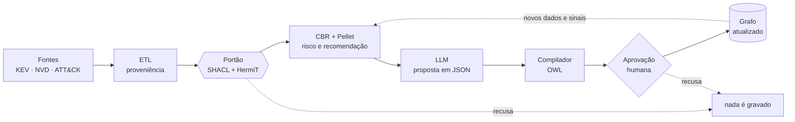

# Masterclass: o ciclo de vida da OntoCSIRT v7

Guia de estudo e de apresentação. Cada fase tem (a) o que acontece tecnicamente, com os ficheiros onde está, e (b) um texto para dizer à banca em cerca de um minuto (130–150 palavras). Os números vêm de execuções reais e indicam a fonte; para os regenerar: `python ontocsirt_v7.py all` (artigo) e `python lifecycle_metrics.py --live` (ciclo de vida).

A versão detalhada, com os ficheiros de cada passo, está em [`ciclo_de_vida.mmd`](ciclo_de_vida.mmd).

**A ideia central, numa frase:** o modelo de linguagem *propõe*, a lógica *verifica* e o humano *decide*. Nada entra no grafo sem passar por um raciocinador e por restrições formais; nada muda a estrutura da ontologia sem aprovação explícita.

---

## Fase 1 — Ingestão

**(a) O que acontece.** Os dados entram por três caminhos.
- **ETL em lote** ([`ingest_real_cases.py`](../ingest_real_cases.py)): cruza o catálogo KEV da CISA (CVEs com exploração confirmada), o mapeamento CTID KEV→ATT&CK (a técnica de exploração) e a API 2.0 do NVD (CVSS e impactos). Cada CVE vira um ramo VERIS completo: `Vulnerability`, `Weakness`, `AttackPattern`, `ThreatAction`, `Asset`, `Incident` e `Case`.
- **Aquisição assistida** ([`ontoevo/enrich.py`](../ontoevo/enrich.py)): o Gemini só preenche lacunas — 1347 das 1766 CVEs do KEV não têm mapeamento CTID. Cada valor proposto é verificado no catálogo oficial (CWE 5.0, ATT&CK 16.1); um valor que não verifica faz a CVE ser recusada, nunca inventada.
- **Tempo real** ([`nvd_enricher.py`](../nvd_enricher.py)): quando um alerta chega com uma CVE desconhecida, o webhook consulta o NVD (cache de 24 h, limite de 5 ou 50 pedidos por 30 s).

Em todos os caminhos o CVSS vem só do NVD e cada campo leva a sua origem (`:cweSource`, `:techniqueSource`, `:assetTypeSource`). Os dados vão para um ficheiro próprio (`OntoCSIRT_v7_acquired.ttl`); o `OntoCSIRT_v7.ttl` do artigo fica congelado (SHA-256 `8c2fc5f00fae…`, verificado nos testes).

**(b) Para a banca (1 min).** "A ontologia não vive isolada: ela é alimentada por fontes públicas e autoritativas — o catálogo KEV da CISA, a base NVD do NIST e o ATT&CK da MITRE. Há três portas de entrada: uma carga em lote, uma aquisição assistida por um modelo de linguagem e uma consulta em tempo real disparada por um alerta. O princípio é sempre o mesmo: fatos vêm das fontes oficiais, e cada valor guarda de onde veio. O modelo de linguagem só entra para preencher lacunas — por exemplo, a técnica ATT&CK de uma CVE que ainda não foi mapeada — e mesmo assim o valor é conferido no catálogo oficial; se não confere, a CVE é recusada. A pontuação CVSS nunca vem do modelo. E a ontologia publicada no artigo nunca é reescrita: os dados novos vão para um arquivo separado, o que mantém os resultados do artigo reprodutíveis."

## Fase 2 — Quality Gate

**(a) O que acontece.** Antes de qualquer gravação, o grafo **composto** (base + extensão + evolução + dados + o que vai entrar) passa por [`validar_ingestao.validate`](../validar_ingestao.py), com duas lógicas complementares.
- **SHACL (mundo fechado).** Verifica o que a OWL, de mundo aberto, não verifica: cardinalidades (incidente com os quatro eixos VERIS), vocabulários controlados (nível de risco, impacto CVSS), padrões (CVE, CWE, ATT&CK), duplicados (CVE, ator) via SHACL-SPARQL e, para a TBox criada pela evolução, rótulo, definição, superclasse, proveniência, conceito duplicado e núcleo protegido (`shapes_v7.ttl`, `shapes_ingest.ttl`, `shapes_evo.ttl`).
- **HermiT (OWL 2 DL).** Verifica a consistência e procura **classes insatisfazíveis**: uma classe impossível não torna a ontologia inconsistente enquanto não tiver membros, mas é um erro de modelação.
- O **Pellet** acrescenta a verificação com as regras SWRL.

Os códigos de saída servem para CI. O autoteste bloqueia 8 de 8 defeitos e a injeção de defeitos do artigo deteta 10 de 10. O próprio portão encontrou um defeito real nesta versão: `:kevDateAdded` usava `xsd:date`, que não pertence ao mapa de tipos do OWL 2. O HermiT recusou a extensão, e a correção está na migração `m001`.

**(b) Para a banca (1 min).** "Antes de gravar qualquer coisa, os dados passam por um portão com duas lógicas diferentes, porque uma não substitui a outra. A primeira é o SHACL, que trabalha em mundo fechado: ele exige, por exemplo, que todo incidente tenha ator, ação, ativo e atributo, e que um identificador CVE tenha o formato certo. A OWL não consegue exigir isso, porque assume mundo aberto. A segunda é o raciocinador HermiT, que prova que a ontologia continua logicamente consistente e que nenhuma classe ficou impossível de ter membros. Se qualquer verificação falha, nada é gravado. Medimos a eficácia injetando defeitos de propósito: os dez do artigo e mais oito de ingestão foram todos bloqueados. E o portão encontrou um defeito real na nossa própria extensão: um tipo de dado que saía do OWL 2 DL, que corrigimos com uma migração documentada."

## Fase 3 — Inferência

**(a) O que acontece.**
- **Pellet com 8 regras SWRL.** Deriva o nível de risco a partir do CVSS (R1a–R1d), os ativos com incidentes críticos recorrentes (R3), os incidentes que partilham ator (R4) ou fraqueza (R5) e as soluções candidatas vindas de casos com a mesma fraqueza (R6). Duas classes definidas são classificadas pela lógica de descrição.
- **CBR** ([`ontocsirt_v7.sim`](../ontocsirt_v7.py)). Ordena os casos por uma similaridade ponderada sobre fraqueza, padrão, ativo, atributo e ator. O crédito parcial "mesma categoria" passa a ser a medida de Wu-Palmer sobre a hierarquia lida do próprio grafo ([`ontotax.py`](../ontotax.py)). Na hierarquia de dois níveis do artigo ela é idêntica à original: o LOOCV é igual, consulta a consulta.
- **Resultado na base do artigo** (24 casos, 18 sintéticos, política definida pelo autor): Acc@1 = 0,688, contra 0,292 da classe majoritária (`evidence_v7/loocv.json`).
- **Em produção, o webhook faz o mesmo para cada alerta.** Para a CVE-2024-3400 (CVSS 10,0) inferiu risco *Critical* pela R1a e recomendou `CoA_Patch` com confiança 0,36. A confiança está abaixo de 0,5, por isso a resposta pede aprovação humana (`evidence_v7/lifecycle.json`).

**(b) Para a banca (1 min).** "Com os dados validados, entram duas formas de raciocínio. A primeira é dedutiva: o Pellet aplica oito regras SWRL e deriva conhecimento que não estava escrito. Por exemplo, CVSS acima de nove implica risco crítico; dois incidentes com a mesma fraqueza se relacionam; e a solução de um caso com a mesma fraqueza vira candidata. A segunda é por analogia, o raciocínio baseado em casos: comparamos o incidente novo com os históricos usando uma similaridade que aproveita a hierarquia da ontologia — duas fraquezas da mesma família contam como parcialmente parecidas. Na base do artigo, isso acerta a solução no primeiro lugar em 69% das consultas, contra 29% de sempre chutar a solução mais comum. Com uma ressalva honesta: a base é pequena e majoritariamente sintética. Em produção, um alerta com uma CVE crítica recebe risco e ação recomendada em poucos segundos."

## Fase 4 — Evolução neuro-simbólica

**(a) O que acontece.**
- **Sinais.** A estrutura muda a partir de **sinais determinísticos** detetados nos dados ([`ontoevo/signals.py`](../ontoevo/signals.py)):
  - um sub-ramo oficial da CWE dentro de uma categoria;
  - uma categoria residual que acumula membros;
  - tipos de ativo atribuídos por omissão;
  - relações guardadas como texto;
  - co-ocorrência entre padrão e solução;
  - padrões ATT&CK sem classes por tática.
- **Proposta pelo Gemini** ([`ontoevo/agent.py`](../ontoevo/agent.py)). O modelo investiga com 8 ferramentas **só de leitura** (hierarquia, membros, catálogo CWE, ATT&CK, SPARQL e uma verificação a seco) e devolve no máximo 3 propostas em JSON validado por um esquema Pydantic (saída estruturada).
- **Compilação** ([`ontoevo/compiler.py`](../ontoevo/compiler.py)). O compilador traduz a proposta para OWL de forma determinística, numa gramática restrita: classe nova, propriedade de objeto, classificação de indivíduos e classes definidas `P ⊓ ∃p.C` ou `P ⊓ ∃p.{i}`. O modelo nunca escreve Turtle.
- **Portão da evolução** ([`ontoevo/evogate.py`](../ontoevo/evogate.py)):
  - SHACL e meta-shapes;
  - HermiT: classes insatisfazíveis e **redundância** (uma classe nova inferida equivalente a uma existente é recusada);
  - Pellet;
  - as 8 questões de competência do artigo como regressão.

Os testes mostram o HermiT a classificar sozinho os membros de uma classe definida e a recusar uma classe equivalente.

**(b) Para a banca (1 min).** "A parte mais nova é a evolução da própria estrutura da ontologia, e não só dos dados. O processo começa sem IA: um detetor determinístico encontra sinais nos dados, por exemplo, três das quatro fraquezas de memória da base descendem do mesmo ramo oficial da CWE. Esse sinal vai para o modelo de linguagem, que investiga a ontologia com ferramentas só de leitura e devolve uma proposta num formato JSON controlado. O modelo nunca escreve OWL. Um compilador traduz a proposta, e então a parte simbólica verifica: o HermiT confirma que a classe é possível e que não é só um sinônimo de uma classe existente, o Pellet confirma a consistência com as regras, e as questões de competência do artigo continuam respondendo certo. Por isso chamamos de neuro-simbólico: a rede neural sugere, a lógica formal tem a palavra final técnica."

## Fase 5 — Governança humana

**(a) O que acontece.**
- **Ciclo de vida das propostas** ([`ontoevo/proposals.py`](../ontoevo/proposals.py)): `pending` → `approved` → `applied`, com `invalid`, `failed-gate`, `rejected` e `failed-apply` para os outros desfechos.
- **Aprovar** exige o nome de quem aprova.
- **Aplicar** faz cinco coisas:
  - recompila e repassa o portão sobre a base **atual**;
  - faz cópia de segurança;
  - acrescenta um bloco ao [`OntoCSIRT_v7_evo.ttl`](../OntoCSIRT_v7_evo.ttl) com `evo:proposalId`, `evo:approvedBy` e `evo:approvedOn`;
  - incrementa `owl:versionInfo` (`evo-N`) e regista em `evolution/CHANGELOG.json`;
  - verifica tudo de novo e restaura as cópias se algo falhar.
- **Evolução monótona.** Só se acrescenta. A única retração permitida — sair da categoria residual ou de um tipo de ativo atribuído por omissão — acontece só nos ficheiros de dados.
- **Aplicadas até hoje** (2026-11-03), ambas aprovadas pelo autor:
  - `evo-1`: `MemoryBufferBoundsWeakness ⊑ MemorySafetyWeakness`, ramo CWE-119 (CWE-787, CWE-125, CWE-416);
  - `evo-2`: `CommandInjectionWeakness ⊑ InjectionWeakness`, ramo CWE-77.
- **Retenção.** No CBR, o `POST /retain` grava como caso a ação aprovada por um analista para um alerta real (`analyst:retain`, o único desfecho observado).

**(b) Para a banca (1 min).** "A última palavra é sempre de uma pessoa. Uma proposta que passa no portão fica pendente; só entra na ontologia depois de um analista aprovar, e o nome dele fica gravado no próprio axioma, junto com a justificativa e a evidência. Na hora de aplicar, o sistema repete todas as verificações sobre a base atual, porque ela pode ter mudado desde a aprovação, guarda uma cópia e versiona: a ontologia está hoje na versão evo-2. Se a verificação final falhar, tudo é restaurado automaticamente. A evolução só acrescenta, nunca apaga, o que preserva a rastreabilidade. As duas mudanças aplicadas criaram subcategorias de fraqueza ancoradas na hierarquia oficial da CWE, e o motor de recomendação passou a usá-las imediatamente, sem mudar código. O mesmo princípio vale para os casos: uma resposta só vira caso histórico quando um analista a aprova."

---

## Perguntas difíceis que a banca provavelmente fará (e respostas honestas)

1. **"Foi o Gemini que criou a evo-1 e a evo-2?"** Não. As duas propostas foram redigidas pelo autor, com apoio de um assistente de programação, e submetidas ao mesmo pipeline (compilador, portão, aprovação) que uma proposta do Gemini percorreria. O registo diz isto em `evo:proposedBy`. O caminho do Gemini está implementado e testado com respostas simuladas, validadas contra os tipos do SDK oficial (`google-genai` 2.34), mas **não foi executado contra a API real** neste trabalho (sem `GEMINI_API_KEY`). É a primeira coisa a fazer como trabalho futuro, com avaliação: hold-out do mapeamento CTID, taxa de propostas aprovadas e taxa de rejeição pelo portão.
2. **"O Acc@1 de 0,688 é em dados reais?"** Não. São 24 casos, 18 sintéticos, com uma política de resposta definida pelo autor; mede se a recuperação reconstrói uma política conhecida, não se as respostas são eficazes. Na base real (KEV), os rótulos vêm de uma política por categoria de CWE, que também entra na similaridade: avaliar ali é circular, por isso não reportamos Acc@1 nessa base.
3. **"Isso é mesmo neuro-simbólico?"** É uma integração em que o componente neural só propõe e o simbólico verifica (padrão *LLM-as-proposer, reasoner-as-verifier*). Não há aprendizagem conjunta nem embeddings dentro do raciocinador. Use o termo com essa definição explícita.
4. **"E se o modelo alucinar?"** Quatro barreiras: (i) fatos (CVSS, CWE, técnica) só de fontes oficiais ou verificados em catálogo; (ii) saída estruturada validada localmente; (iii) compilador com gramática restrita e verificações estruturais; (iv) portão lógico (SHACL, HermiT, Pellet, questões de competência) e aprovação humana. Os testes injetam uma técnica `T9999` e uma `CWE-99999` inventadas, e ambas são recusadas.
5. **"Escala?"** O Pellet leva ~2 s com 19 incidentes, mas R3–R6 comparam pares; o README antigo regista ~50 s com 106 incidentes. Para bases grandes: `--reasoner none` no webhook, ou partição da base. Não foi feito estudo de escalabilidade.
6. **"Houve validação por especialistas?"** Não. É a principal limitação, partilhada com o artigo (o OntoCSD teve 12 especialistas).
7. **"O que acontece se o NVD cair?"** Com a cache válida (24 h), nada; sem cache, o webhook responde `manual_review` com o motivo e não grava nada. Isto está testado com uma rede simulada em baixo, não com uma queda real do NVD.
